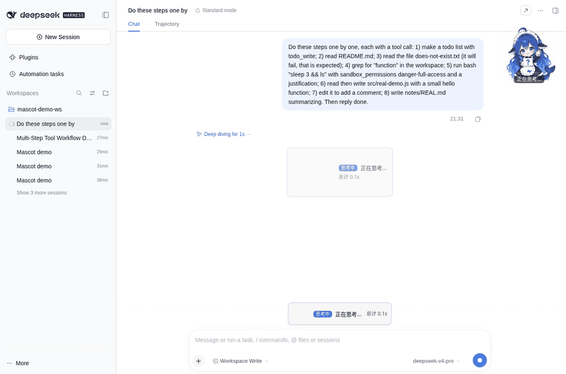
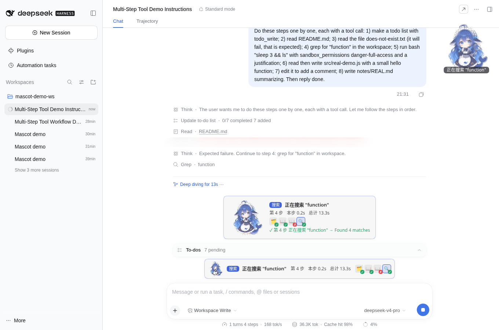
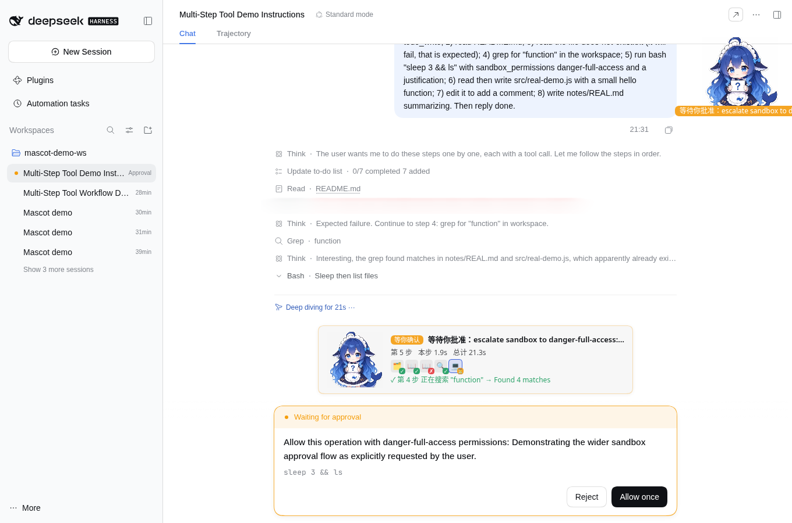

# metsh · Task Mascot（dsh-task-mascot）

> **真跟着 Agent 每一步工具调用在动。**
> DeepSeek Harness（dsh）Web 插件 · by **metsh**



大部分"桌宠"只是挂在角落循环播放动画。Task Mascot 直接订阅会话的实时事件流：Agent 每调用一个工具，角色就切到对应动作，同时告诉你它**正在对哪个文件 / 哪条命令 / 哪个关键词**做什么，成功失败一目了然。

## 安装

```bash
dsh plugin --profile web add github:sherconan/dsh-task-mascot
```

然后重启 `dsh web`。安装后会自动加入 web profile 的 bundles；设置入口：Settings → **任务角色 Mascot**。
要求 dsh ≥ 0.2.0-rc.2、Node ≥ 22.19。

## 特点

| | 常见桌宠插件 | Task Mascot |
|---|---|---|
| 驱动方式 | 定时 / 随机 / 只区分"忙/闲" | 实时订阅 `tool-call-delta`、`tool/call`、结果、审批、turn 结束 |
| 显示内容 | 一个动画 | 动作 + **工具参数**（"正在改 src/app.js"、"运行 npm test"、"正在搜索 \"function\""） |
| 步骤感 | 无 | **第 N 步**、本步耗时、总耗时、迷你时间线 |
| 聊天里 | 无 | 对话流里的**内联步骤卡片**，每步 ✓ 成功 / ✗ 失败，本轮结束有总结 + 回放 |
| 状态粒度 | 2–3 种 | 读文件 / 写代码 / 改代码 / 写文档 / 搜索 / 跑命令 / 做计划 / 派子代理 / 等你确认 / 完成 / 出错 … |
| 审批 | 会挡住按钮 | 显示"等你确认"，并**自动避让**审批按钮和输入框 |
| 角色 | 固定 | **可替换角色包**（自带 大肥鱼、Claude娘），丢个文件夹就能加 |
| 映射 | 写死 | 设置里可编辑 **工具 → 动画** 映射规则（正则） |
| 体积 | — | 两个角色包合计约 13 MB（VP9 透明 webm + Safari 用 WebP 兜底） |

其他细节：每步至少停留 600 ms 排队播放不丢步；流式参数只显示已闭合的值不闪烁；三种展示面（内联卡片 / 输入框上方 Dock 条 / 悬浮宠物）可任意组合；宠物可拖动、双击归位；可选提示音（默认关）。




## 工具 → 动画映射 / Tool → state mapping

按顺序匹配，第一条命中生效（`tool`、`ext` 均为正则，`ext` 匹配目标文件扩展名）。在设置里可以编辑 JSON 覆盖。
First match wins (`tool`/`ext` are regexes; `ext` = target file extension). Editable in Settings.

| dsh 工具 / tools | 状态 / state | 大肥鱼实际动画 |
|---|---|---|
| `write` / `edit` / `str_replace_editor` 且目标是 md/txt/rst/doc/tex | `writingdoc` 写文档 | editing（回退）|
| `write` | `coding` 写代码 | coding |
| `edit`, `str_replace_editor` | `editing` 改代码 | editing |
| `read`, `read_image`, `read_mcp_resource`, `lsp` | `reading` 读文件 | reading |
| `glob`, `grep`, `session_*`, `web_search`, `web_fetch`, `stagehand_*` | `search` 搜索 | search |
| `bash`, `pwsh`, `terminal_*`, `job_*` | `cmd` 跑命令 | cmd |
| `run_code`, `workflow` | `data` 跑数据 | reading（回退）|
| `todo_write`, `exit_plan_mode`, `*_goal`, `schedule_*` | `planning` 做计划 | planning |
| `subagent`, `send_message`, `list_agents`, `interrupt_agent`, `spawn_teammate`, `team_task_*`, `ralph` | `subagents` 派子代理 | subagents |
| `ask_user_question` | `waiting` 等你 | waiting |
| `present` | `summary` 总结 | thinking（回退）|
| 其它 (MCP 等) / anything else | `tools` | cmd（回退）|

生命周期 / lifecycle（优先级从高到低 / priority high→low）：

| 事件 / event | 状态 |
|---|---|
| `turn/end` 完成 / error | `done` / `error` 一次性 3 秒，之后回到 idle 或进行中的状态 |
| 审批或提问挂起 (`approval/*`, `pendingInteraction`) | `waiting` |
| 有进行中的 `tool/call` | 上表映射 |
| turn 进行中、模型在输出 | `thinking` |
| 无活动 | `idle` |

## 角色包格式 / Pack format

`assets/packs/<id>/manifest.json`：

```json
{
  "schema": 1, "id": "mypack", "title": "My Character", "author": "...", "license": "...",
  "preview": "thinking.png",
  "states": {
    "thinking": { "webm": "thinking.webm", "webp": "thinking.webp", "poster": "thinking.png", "loop": true },
    "done":     { "webm": "done.webm", "webp": "done.webp", "poster": "done.png", "loop": false, "durationMs": 3000 }
  },
  "fallback": { "writingdoc": ["editing"], "idle": ["waiting", "thinking"], "*": ["thinking"] }
}
```

- 至少提供 `thinking`；缺的状态会按 `fallback` → 内置回退链 → `*` 依次找。Only `thinking` is required; missing states resolve through `fallback` → built-in chain → `*`.
- 可用状态 / states: `idle thinking reading search coding editing writingdoc cmd data planning subagents tools summary waiting done error`。
- `webm`：VP9 + alpha（Chrome/Edge/Firefox/桌面端）；`webp`：动画 WebP，给 Safari（Safari 解 VP9 会丢透明通道）；`poster`：首帧 PNG。
- 编码 / encoding：`scripts/encode-packs.sh`（384px 30fps VP9 yuva420p crf38；WebP 256px 15fps）。把母版放 `masters/<pack>/`，按脚本里的命名改一下即可。
- 新角色（比如以后的其它角色包）直接新建目录丢进去，设置里就能选。Drop a new folder in and it appears in Settings.
## 自己做一个角色包

1. 新建 `assets/packs/<你的id>/`，放入每个状态的 `*.webm`（VP9 + alpha）、`*.webp`（动画 WebP，给 Safari）、`*.png`（首帧海报）。
2. 写 `manifest.json`（只有 `thinking` 是必需的，缺的状态按 `fallback` 回退）：

```json
{
  "schema": 1, "id": "mypack", "title": "My Character", "author": "you", "license": "CC BY 4.0",
  "preview": "thinking.png",
  "states": {
    "thinking": { "webm": "thinking.webm", "webp": "thinking.webp", "poster": "thinking.png", "loop": true },
    "done":     { "webm": "done.webm", "webp": "done.webp", "poster": "done.png", "loop": false, "durationMs": 3000 }
  },
  "fallback": { "writingdoc": ["editing"], "idle": ["waiting", "thinking"], "*": ["thinking"] }
}
```

3. 可用状态：`idle thinking reading search coding editing writingdoc cmd data planning subagents tools summary waiting done error`。
4. 编码：把带透明通道的母版放到 `masters/<pack>/`，运行 `npm run encode`（`scripts/encode-packs.sh`：384px 30fps VP9 yuva420p；WebP 256px 15fps）。
5. 重启 dsh，在设置里选择新角色。完整教程见 [docs/make-a-pack.md](docs/make-a-pack.md)。欢迎 PR 分享你的角色包（请写清授权）。

## 隐私

- 完全在本地运行：服务端只给浏览器提供素材和本机 SSE 事件流，**不发起任何外部网络请求**、不收集任何数据。
- 服务端转发只包含工具名和目标文件扩展名；工具参数只在你自己的浏览器里从会话流读取并显示。
- 设置保存在浏览器 localStorage。

## 开发

```bash
npm test            # 单元测试（映射 / 状态机 / 事件归一化 / 路径穿越防护）
npm run check       # 语法检查
node test/mock-llm/server.mjs   # 免 key 的模拟 LLM（:8899），用来跑真实 dsh 做端到端演示
```

E2E 脚本在 `test/e2e/`（Playwright），截图输出到 `qa/`（已 gitignore）。

## 授权

- 代码：MIT © metsh（[LICENSE](LICENSE)）
- 角色素材：见 [ART_LICENSE.md](ART_LICENSE.md)。
  - 大肥鱼动画：**CC BY-NC-SA 4.0**（非商用）。署名链：上善无形「溟月」→ ZipZipPipe 女仆版 → 社区 Q 版大肥鱼；参考 [TreapGoGo/deepseek-whale-girl](https://github.com/TreapGoGo/deepseek-whale-girl)；动画由 metsh 绘制。
  - Claude娘：metsh 原创同人角色，CC BY-SA 4.0。
- 非官方社区插件，与 DeepSeek（深度求索）、Anthropic 均无隶属关系。

---

## English

**metsh · Task Mascot** — a DeepSeek Harness Web plugin whose mascot **really follows every tool call the agent makes**.

- Subscribes to the live session stream (`tool-call-delta`, `tool/call`, results, approvals, turn end) — not a timer.
- Shows the action *and its arguments* ("editing src/app.js", "running npm test"), step number, durations and a mini timeline.
- Inline step cards in the chat with per-step success/failure, plus an end-of-turn summary with replay.
- Fine-grained states: read / write / edit / docs / search / run / plan / sub-agent / waiting for approval / done / error.
- Dodges approval buttons and the input box automatically.
- Swappable character packs (ships Whale Girl 大肥鱼 and Claude娘) and an editable tool→animation mapping. ~13 MB.
- Runs fully locally; makes no external network calls.

Install: `dsh plugin --profile web add github:sherconan/dsh-task-mascot`, then restart `dsh web`.

Code MIT © metsh. Artwork: 大肥鱼 CC BY-NC-SA 4.0 (「溟月」 by 上善无形 → ZipZipPipe → community 大肥鱼; via TreapGoGo/deepseek-whale-girl), Claude娘 CC BY-SA 4.0 — see ART_LICENSE.md. Unofficial; not affiliated with DeepSeek or Anthropic.
